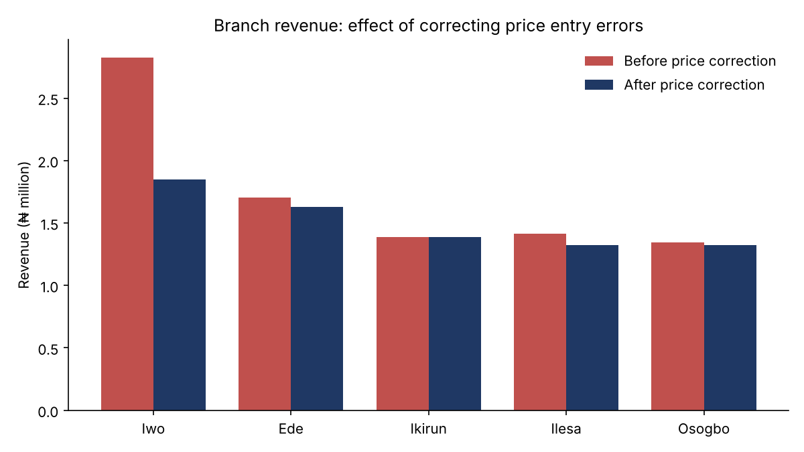
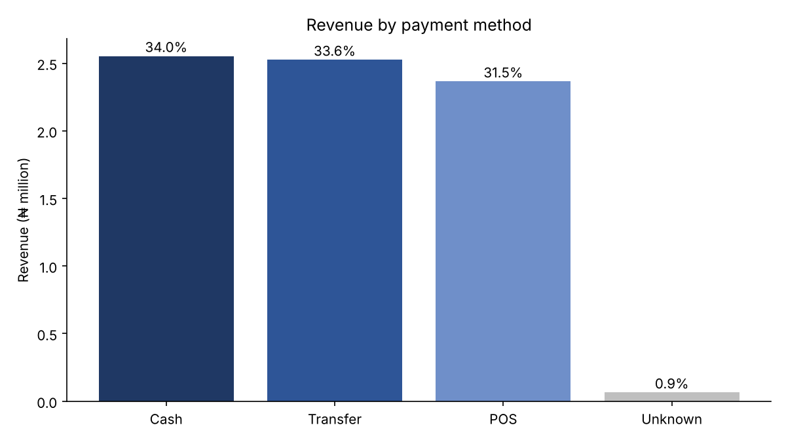
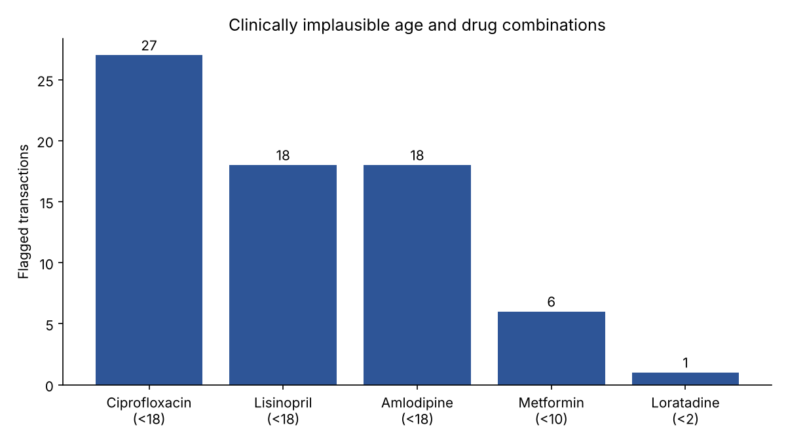

# Pharmacy Sales: SQL Data Cleaning, Analysis and Clinical Audit

A SQL project that turns a messy pharmacy sales export into an audited, analysis-ready table, then uses it to answer business questions and to check whether the drugs sold make clinical sense for the customer's age.

**Author:** Ojo Elijah Olalekan, Pharmacology graduate and research data analyst
**Tools:** MySQL 8 / MariaDB, SQL (CTEs, window functions, CASE logic), Python (dataset generation and charts)
**Data:** Synthetic practice dataset, 1,525 transactions from five pharmacy branches in Osun State, 2025

> The dataset is synthetic and was generated for practice. The findings demonstrate method and do not describe a real pharmacy.

## The problem

The raw export could not be trusted for reporting. It contained 25 duplicate transactions, 10 rows with zero or negative quantities, 12 impossible calendar dates, 8 unit prices that were 10 to 100 times too high, inconsistent product, branch and payment labels, blank categories, and customer ages such as 0, -5 and 999.

## Approach

1. **Profile before changing anything.** Counts of nulls, distinct values and anomalies per column.
2. **Clean with full traceability.** Duplicates removed with window functions. Invalid rows moved to a `pharmacy_sales_rejected` table with a reason. Every correction is flagged in its own column (`date_corrected`, `price_corrected`, `age_invalid`).
3. **Reconcile.** A check proves every raw row is accounted for: 1,525 raw rows = 25 duplicates + 10 rejected + 1,490 clean.
4. **Analyse.** Branch performance, payment mix and top category per month.
5. **Audit clinically.** Age rules per drug, written from pharmacology knowledge, flag implausible sales for review.

## Key findings

**Price entry errors change which branch looks best.** Eight bad prices added about ₦1.17 million of fake revenue, ₦976,500 of it in Iwo. After correction Iwo still leads on revenue (₦1,850,700), but Ede has the highest average order value (₦5,385.76 vs ₦5,364.35).



**Payments are close to evenly split:** Cash 34.01%, Transfer 33.64%, POS 31.50% and Unknown 0.86%.



**70 sales (₦432,300) failed the clinical plausibility check**, for example antihypertensives and ciprofloxacin recorded for minors. The recommendation is to escalate them for review, not to delete or edit them, so both the financial and the medical record stay intact.



Antibiotics are the top category in seven months and respiratory products in the other five.

## Repository structure

```
pharmacy-sales-sql-analysis/
├── data/
│   ├── pharmacy_sales_raw.csv        # messy input (1,525 rows)
│   └── pharmacy_sales_clean.csv      # output of the pipeline (1,490 rows)
├── sql/
│   ├── 01_create_raw_table.sql       # create database and raw table, load the CSV
│   ├── 02_cleaning_pipeline.sql      # builds pharmacy_sales_clean and pharmacy_sales_rejected
│   ├── 03_validation_checks.sql      # reconciliation and quality checks
│   ├── 04_business_analysis.sql      # branch, payment and monthly category analysis
│   └── 05_clinical_audit.sql         # clinical plausibility audit
├── docs/
│   ├── Pharmacy_Sales_Technical_Report.docx
│   ├── data_dictionary.md
│   ├── planted_data_issues.md        # what was deliberately wrong in the synthetic data
│   └── portfolio_case_study.md
├── images/                           # charts used in this README
└── scripts/
    └── generate_dataset.py           # reproduces the synthetic raw dataset (seed 42)
```

## How to run it

1. Run `sql/01_create_raw_table.sql` (start the MySQL client with `--local-infile=1`, or use the Workbench import wizard and keep `sale_date` as text). Expect 1,525 rows.
2. Run `sql/02_cleaning_pipeline.sql`.
3. Run `sql/03_validation_checks.sql`. Expected: 1,490 clean rows, 10 rejected rows, no unaccounted sale IDs, 14 distinct products, 0 null categories.
4. Run `sql/04_business_analysis.sql` and `sql/05_clinical_audit.sql`.

## Assumptions and limitations

- The two impossible dates (`2026-13-05` and `2025-02-30`) are remapped by assumption to `2025-05-13` and `2025-02-28`. They are flagged in `date_corrected` and can be excluded.
- The reference price per product is the lowest observed price, which works because the errors only inflate prices. A product master table would be the production fix.
- Impossible ages become NULL and are flagged, never guessed.
- Customer ages were generated independently of products, so clinical and branch patterns reflect chance, not real behaviour.

## Skills demonstrated

Data profiling, data cleaning, window functions, CTEs, pattern-based date parsing, validation and reconciliation, business analysis, clinical domain validation, technical reporting.
